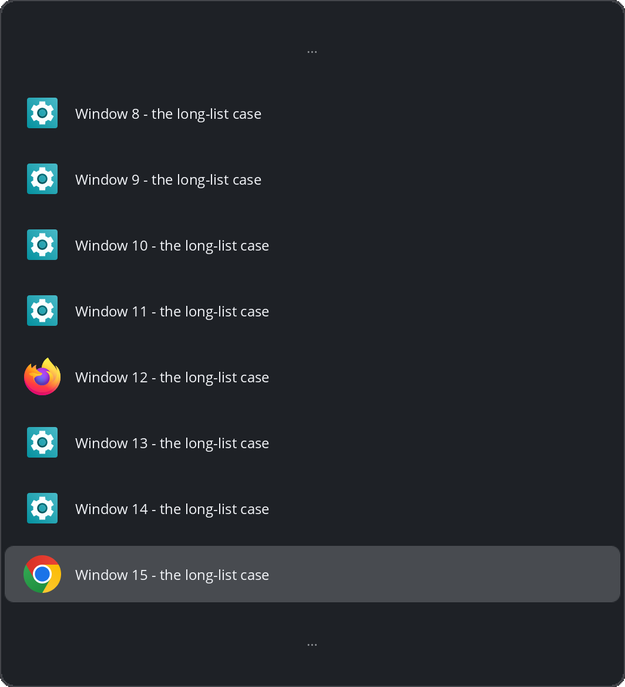
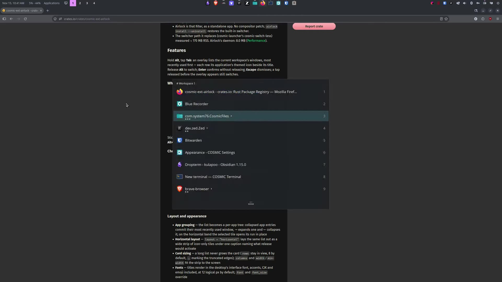

# Airlock

Workspace-isolated Alt+Tab for the COSMIC™ desktop: the switcher lists and
cycles only the windows on the **current workspace**, so nothing you parked
elsewhere leaks into your focus.



> Airlock is third-party software for the COSMIC™ desktop. It is not official
> COSMIC software and is not affiliated with or endorsed by System76.

**Status:** [v0.4.5](https://github.com/l1br3-io/cosmic-ext-airlock/releases/tag/v0.4.5) ·
released 2026-11-15 · early, actively developed — the core Alt+Tab gesture is
solid; same-app cycling and pointer input are newer.

## Demo

[](https://l1br3-io.github.io/cosmic-ext-airlock/#demo)

Click on the thumbnail to watch the demo on the project website: the
five-minute video plays the whole gesture on a real COSMIC desktop —
switching, type-to-filter, closing from the card, the horizontal band.

## Why

- The built-in COSMIC switcher lists every window on every workspace, most
  recently used first. There is no workspace filter, and the request for one
  ([pop-os/cosmic-epoch#1777](https://github.com/pop-os/cosmic-epoch/issues/1777))
  is still open.
- Airlock is that filter, as a standalone app. No compositor patch;
  `airlock install --uninstall` restores the built-in switcher.
- The switcher path it replaces (cosmic-launcher's cosmic-switch-less)
  measured ≈ 170 MB RSS. Airlock's daemon: 8.0 MB ([Performance](#performance)).

## Features

Hold **Alt**, tap **Tab**: an overlay lists the current workspace's
windows, most recently used first — each row its application's themed
icon beside its title. Release **Alt** to switch; **Enter** confirms
without releasing; **Escape** dismisses; a tap released before the
overlay appears still switches.

### What the list shows

- **Workspace isolation** — plain Alt+Tab reaches only the current
  workspace's windows; a workspace can opt into the global list
  ([Settings](docs/settings.md))
- **All-windows mode** — **Alt+Esc** opens the same card over every
  workspace's windows, grouped by workspace with yours first;
  **Alt+Shift+Esc** steps it backwards
- **Type to filter** — while the card is up, typing narrows it by
  title or app name, case-insensitive; works in every mode
- **Workspace label** — `show_workspace = true` names the workspace
  you pressed on, the anchor for workspaces opted out of isolation
- **Parked windows** — `show_minimized = true` lists minimized windows
  too, after the live ones, workspace by workspace; Enter on one
  un-minimizes and focuses it

Sticky windows appear on every workspace; minimized windows nowhere
unless `show_minimized = true` opts them in; one **Alt+Esc** press
reaches any window regardless of the rules.

### Choosing and closing

- **Direct access** — **Ctrl+N** (1–9, keypad included) switches to
  the Nth window at once, like a click; each row shows its digit
- **App cycling** — **Alt+`** (the key above Tab) cycles the current
  application's windows; **Alt+Shift+`** steps backwards
- **Quick-toggle** — `airlock quick-toggle` flips to the
  second-most-recent window without an overlay; no default key —
  bind it in Settings → Input → Keyboard → Shortcuts → Custom
- **Close from the card** — **Alt+minus** closes the selected row's
  window and the card stays up; hovering a row reveals a × badge
  that closes on click
- **Pointer input** — hover moves the selection, click switches, the
  wheel steps; the pointing-hand cursor marks every click target
- **Cycle within app group** — **Alt+`** steps through the app's group windows, then
  the next app; **Alt+Shift+`** steps backwards

### Layout and appearance

- **App grouping** — the list becomes a per-app tree: collapsed app
  entries commit their most recently used window, → expands one and
  ← collapses it; on the horizontal band the selected tile opens its
  run in place
- **Horizontal layout** — `layout = "horizontal"` lays the same list
  out as a wide strip of icon-only tiles under one caption naming
  what release would activate
- **Card sizing** — a long list never grows the card (`rows` stay in
  view, 8 by default, `…` marking the truncated edges); `columns` and
  `width`/`min-width` fit the strip to the screen
- **Fonts** — titles render in the desktop's interface font, accents,
  CJK and emoji included, at 12 logical px by default; `font` and
  `font_size` override

Preview the card without a COSMIC session:

```sh
cargo run --example overlay-preview -- preview.png
```

Every key, pointer rule, the frozen-list rule, and the card's
measurements:
[how the switcher behaves](docs/how-it-works.md).

## Install

Requires a COSMIC desktop session (epoch). One command, prebuilt binary,
no Rust:

```sh
curl -fsSL https://raw.githubusercontent.com/l1br3-io/cosmic-ext-airlock/main/scripts/install.sh | sh
```

It downloads the x86_64 binary, verifies its sha256, installs it into a
directory on your `PATH`, and runs `airlock install`. If that directory is
not on `PATH`, it appends an export line to `~/.bashrc` and `~/.profile`
(zsh: `~/.zshrc`; fish: it prints the `fish_add_path` line) so new
terminals find `airlock`, then still runs the takeover. No sudo. To read
the script before running it:

```sh
curl -fsSL https://raw.githubusercontent.com/l1br3-io/cosmic-ext-airlock/main/scripts/install.sh -o airlock-install.sh
less airlock-install.sh
sh airlock-install.sh   # AIRLOCK_NO_INTEGRATION=1 installs the binary alone
                        # AIRLOCK_NO_MODIFY_PATH=1 prints the PATH line
                        # instead of appending it to your shell startup
```

### With cargo

Rust 1.93+:

```sh
cargo install cosmic-ext-airlock   # from crates.io → ~/.cargo/bin/airlock
airlock install                    # the complete setup: keybind takeover
                                    # + app icon & desktop entry (user level)
                                    # + commented starter config
```

### Build dependencies

`cargo install` compiles from source, and cargo cannot install system
libraries — the build needs a C toolchain, pkg-config, and the
Wayland/xkbcommon headers (the runtime libraries ship with every COSMIC
system; these are build-time packages). Install them once:

```sh
sudo apt install build-essential pkg-config libwayland-dev libxkbcommon-dev
```

Or skip the build: the releases carry a prebuilt x86_64 Linux binary,
which needs none of the above (the runtime libraries ship with COSMIC;
the binary requires a glibc at least as new as the build host's — if
yours is older, build from source as above):

```sh
cargo install cargo-binstall         # once, to bootstrap the downloader
cargo binstall cosmic-ext-airlock    # downloads instead of compiling
```

From a checkout, `just install` checks the build prerequisites (C toolchain,
pkg-config, Wayland/xkbcommon headers, cargo) and installs missing ones
through the distro's package manager and rustup. Assets ride the binary:
`airlock install` writes the icon and desktop entry into `~/.local/share`,
never `/usr/share`, and drops a commented starter at
`~/.config/airlock/config.toml` — only when no config is there yet; one
that exists is yours ([settings](docs/settings.md)).

The takeover touches only user-level files in
`~/.config/cosmic/com.system76.CosmicSettings.Shortcuts/v1`:

- `WindowSwitcher` / `WindowSwitcherPrevious` point at `airlock alt-tab` /
  `airlock shift-alt-tab`
- Four marked custom bindings are added for the extra keys; a 0.4-era
  `Alt+Esc` quick-toggle entry is migrated to the new command, never
  skipped
- A key already bound to one of your own shortcuts is skipped and named in
  the output
- Everything survives re-login; the first key press starts the daemon

## Uninstall

```sh
airlock install --uninstall   # restore the previous switcher and remove
                              # the app icon, desktop entry, and unedited
                              # starter config

rm ~/.local/bin/airlock                # remove the binary (installer path)
# and the PATH line the installer appended to ~/.bashrc / ~/.profile
cargo uninstall cosmic-ext-airlock     # or, if cargo installed it
```

- Backups live inside the config files; the pre-install state returns
  byte-for-byte
- An asset file — or the config — you edited by hand is kept and named,
  never silently deleted
- The ignore rule is per key: a slot running some other tool is never
  rewritten
- One degradation: if cosmic-settings has stripped the backup markers,
  `--uninstall` restores the built-in switcher commands best-effort and says
  so. A pre-install third-party switcher cannot be recovered in that one
  case; every other path returns your exact bytes

## Troubleshooting

- **Alt+Tab does nothing.** First press may be starting the daemon (~340 ms
  cold) — press again. If it persists, `airlock list` names any missing
  protocol; check the directory holding `airlock` is on your session
  `PATH`.
- **Another tool fights over WindowSwitcher.** The user-level override is
  one slot; last writer wins. Re-run `airlock install`.

More, including dead extra keys and daemon restarts after logout:
[troubleshooting](https://github.com/l1br3-io/cosmic-ext-airlock/blob/main/docs/troubleshooting.md).

## Performance

Measured on hardware, 2026-11-02 (see the
[checklist](https://github.com/l1br3-io/cosmic-ext-airlock/blob/main/docs/hardware-checklist.md)
for method):

| Measurement | Target | Airlock |
|---|---|---|
| Daemon RSS / threads | < 30 MB | **8.0 MB / 1 thread** |
| Warm press round-trip | < 50 ms | **< 10 ms** |
| Cold press (respawn + settle) | — | ~340 ms |

## Packaging

On [crates.io](https://crates.io/crates/cosmic-ext-airlock) as
`cosmic-ext-airlock`;
[releases](https://github.com/l1br3-io/cosmic-ext-airlock/releases) carry
the tags, notes, and the prebuilt archive with its checksum and
one-command installer. App ID `io.github.l1br3-io.Airlock` — the hyphen matches
the GitHub org. A Launchpad PPA and Flathub are on the roadmap without dates
(see the [research index](https://github.com/l1br3-io/cosmic-ext-airlock/blob/main/docs/research/README.md)).

## Development

- `just install` — self-contained binary in `~/.cargo/bin`; the installed
  keybind keeps working regardless of repo state
- `just run` — daemon from the dev tree; `just stop` first if the installed
  one is serving (single-instance socket)
- Gates: `just test`, `just check` (clippy, warnings denied), `just
  fmt-check`. Runtime needs COSMIC hardware — the
  [hardware checklist](https://github.com/l1br3-io/cosmic-ext-airlock/blob/main/docs/hardware-checklist.md)
  or the [VM guide](https://github.com/l1br3-io/cosmic-ext-airlock/blob/main/docs/vm-development.md)

## Documentation

- [Project website](https://l1br3-io.github.io/cosmic-ext-airlock/) — the
  front door: landing page plus the three user docs, mirrored
- [How the switcher behaves](https://github.com/l1br3-io/cosmic-ext-airlock/blob/main/docs/how-it-works.md)
- [Per-workspace settings](https://github.com/l1br3-io/cosmic-ext-airlock/blob/main/docs/settings.md)
- [Troubleshooting](https://github.com/l1br3-io/cosmic-ext-airlock/blob/main/docs/troubleshooting.md)
- [Hardware verification checklist](https://github.com/l1br3-io/cosmic-ext-airlock/blob/main/docs/hardware-checklist.md)
- [Developing and testing in the COSMIC VM](https://github.com/l1br3-io/cosmic-ext-airlock/blob/main/docs/vm-development.md)
- [Releasing](https://github.com/l1br3-io/cosmic-ext-airlock/blob/main/docs/releasing.md)
- [Research index](https://github.com/l1br3-io/cosmic-ext-airlock/blob/main/docs/research/README.md)

## License

GPL-3.0-only — see [LICENSE](LICENSE).
