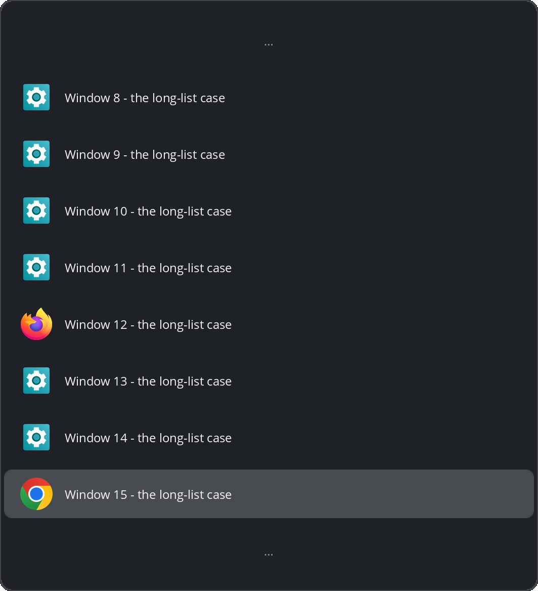

# Airlock

Workspace-isolated Alt+Tab for the COSMIC™ desktop: the switcher lists and
cycles only the windows on the **current workspace**, so nothing you parked
elsewhere leaks into your focus.



> Airlock is third-party software for the COSMIC™ desktop. It is not official
> COSMIC software and is not affiliated with or endorsed by System76.

**Status:** [v0.4.0](https://github.com/l1br3-io/cosmic-ext-airlock/releases/tag/v0.4.0) ·
released 2026-11-09 · early, actively developed — the core Alt+Tab gesture is
solid; same-app cycling and pointer input are newer.

## Why

- The built-in COSMIC switcher lists every window on every workspace, most
  recently used first. There is no workspace filter, and the request for one
  ([pop-os/cosmic-epoch#1777](https://github.com/pop-os/cosmic-epoch/issues/1777))
  is still open.
- Airlock is that filter, as a standalone app. No compositor patch;
  `airlock install --uninstall` restores the built-in switcher.
- The switcher path it replaces (cosmic-launcher's cosmic-switch-less)
  measured ≈ 170 MB RSS. Airlock's daemon: 8.0 MB ([Performance](#performance)).

## How it works

Hold **Alt**, tap **Tab**: an overlay lists the current workspace's windows,
most recently used first. Rows are the application's themed icon (the same
pipeline the COSMIC launcher uses) beside its title.

- **Tab** / **Shift+Tab** step forward / back; arrow keys work too
- Release **Alt** to switch and dismiss; **Enter** confirms without
  releasing; **Escape** dismisses without switching
- A quick tap, released before the overlay appears, still switches
- Pointer: hover moves the selection, click switches, the wheel steps the
  list
- **Ctrl+N** (1–9, keypad too) switches to the Nth window at once, like a
  click; each row shows its digit
- A long list never grows the card: `rows` windows stay in view (8 by
  default) with `…` rows marking the truncated edges, and stepping
  walks the whole list — see
  [Settings](https://github.com/l1br3-io/cosmic-ext-airlock/blob/main/docs/settings.md#rows)
- **A horizontal card** (`layout = "horizontal"`) lays the same list
  out as a wide strip of compact icon-only tiles, one caption at the
  top naming the window the release would activate; stepped with
  Left/Right and addressed by Ctrl+N (a bare digit on each tile) and
  the pointer per tile; apps with several windows show up to three
  count dots under their icon, and `columns` fits the strip to
  two-thirds of the screen (`"auto"`, the default) or pins 3–12
  tiles — see
  [Settings](https://github.com/l1br3-io/cosmic-ext-airlock/blob/main/docs/settings.md#layout)
- **Card width** — `width` and `min-width` hold either card at a floor:
  `"auto"` (the default) sizes from content, `"100%"` fills the
  screen, or set a pixel count. A value below what the card needs
  changes nothing — see
  [Settings](https://github.com/l1br3-io/cosmic-ext-airlock/blob/main/docs/settings.md#width)
- **App grouping** (`grouping = true`) turns the list into a per-app tree:
  collapsed app entries that commit their most recently used window, with
  window-count pips below the app name and an inline caret; → to
  expand one (remembered across gestures) and ← to collapse; Tab, arrows,
  and the wheel walk the visible rows linearly — see
  [Settings](https://github.com/l1br3-io/cosmic-ext-airlock/blob/main/docs/settings.md#grouping)
- **Grouping on the band** (`grouping = true` with
  `layout = "horizontal"`) lays the tree out as one strip: the selected
  app's tile is replaced, in place, by its window run. ↓ opens the run
  and ↑ closes it — the card keeps its width across the two, and an app
  holds a run only while it has two live windows (the caption names the
  app's most recently used window while its tile is selected). Tab
  steps apps from a tile and, inside an open run, steps the run's
  windows with Left/Right — the run staying open until the walk leaves
  it, as the vertical tree's Tab walks an expanded group;
  **`** (the key above Tab) works
  the selected app's group — a tile press opens the app's windows on
  their most recently used one (**Shift+`** on the last), and from
  inside the run the key cycles those windows, wrapping within the
  app. The vertical tree behaves the same from its entries, where an
  expanded entry collapses in place. In every other session the key
  types into the filter
- **Type to filter**: while the card is up, typing narrows it — title or
  app name, case-insensitive, first match selected; Backspace edits,
  Escape clears before it dismisses. Works in every mode
- **Workspace label** (`show_workspace = true`): the card names the
  workspace you pressed on — its name verbatim, or "# Workspace N"
  when the name is just a number or absent, small, top-left on the
  vertical card and bottom-center on the horizontal one. The anchor for
  workspaces opted out of isolation, where the list crosses workspaces — see
  [Settings](https://github.com/l1br3-io/cosmic-ext-airlock/blob/main/docs/settings.md#show-workspace)
- **Close windows from the card**: Alt+minus closes the selected row's
  window and the card stays up for the next; hovering a window row or
  horizontal window tile reveals a small × badge on its icon's top-right
  corner that closes on click. A group entry
  closes its app's front window — every row closes what it activates
- Titles render in the desktop's own interface font — real glyphs,
  real accents, fallback chains for CJK and emoji — at 12 logical px by
  default; a `font` key overrides the family and `font_size` (8–24)
  the size (see
  [Settings](https://github.com/l1br3-io/cosmic-ext-airlock/blob/main/docs/settings.md#font-size)).
  Before 2026-11-07 every title painted in a built-in ASCII pixel font
  that folded punctuation and accents and showed `?` for anything
  without an ASCII form; that fold survives only as the zero-fonts
  floor — the deterministic paint of last resort on a system with no
  loadable fonts.

Preview the card without a COSMIC session:

```sh
cargo run --example overlay-preview -- preview.png
```

Scope and extra keys:

- Sticky windows appear on every workspace; minimized windows nowhere; a
  window on another workspace can never be reached through Airlock. A
  workspace can opt into the global list — see
  [Settings](https://github.com/l1br3-io/cosmic-ext-airlock/blob/main/docs/settings.md).
- **Alt+grave** (the key above Tab) cycles the current application's
  windows;
  **Alt+Shift+grave** starts it stepping backwards; **Alt+Esc** jumps to the
  second-most-recent window with no overlay.
- A small daemon keeps a live compositor snapshot; the keybind stubs
  auto-start it on first press. The overlay is software-rendered.

Every key, pointer rule, the frozen-list rule, and the card's measurements:
[how the switcher behaves](https://github.com/l1br3-io/cosmic-ext-airlock/blob/main/docs/how-it-works.md).

## Install

Requires a COSMIC desktop session (epoch) and Rust 1.93+. On another
compositor the daemon exits with a diagnostic naming the missing protocol.

```sh
cargo install cosmic-ext-airlock   # from crates.io → ~/.cargo/bin/airlock
airlock install                    # the complete setup: keybind takeover
                                    # + app icon & desktop entry (user level)
                                    # + commented starter config
```

`cargo install` compiles from source, and cargo cannot install system
libraries — the build needs a C toolchain, pkg-config, and the
Wayland/xkbcommon headers (the runtime libraries ship with every COSMIC
system; these are build-time packages). Install them once:

```sh
sudo apt install build-essential pkg-config libwayland-dev libxkbcommon-dev   # Debian/Ubuntu/Pop!_OS
sudo dnf install gcc gcc-c++ make pkgconf-pkg-config wayland-devel libxkbcommon-devel   # Fedora
sudo pacman -S --needed base-devel pkgconf wayland libxkbcommon               # Arch
sudo zypper install gcc gcc-c++ make pkg-config wayland-devel libxkbcommon-devel   # openSUSE
```

From a checkout, `just install` checks the build prerequisites (C toolchain,
pkg-config, Wayland/xkbcommon headers, cargo) and installs missing ones
through the distro's package manager and rustup. Assets ride the binary:
`airlock install` writes the icon and desktop entry into `~/.local/share`,
never `/usr/share`, and drops a commented starter at
`~/.config/airlock/config.toml` — only when no config is there yet; one
that exists is yours ([settings](docs/settings.md)).

The takeover touches only user-level files in
`~/.config/cosmic/com.system76.CosmicSettings.Shortcuts/v1`:

- `WindowSwitcher` / `WindowSwitcherPrevious` point at `airlock alt-tab` /
  `airlock shift-alt-tab`
- Three marked custom bindings are added for the extra keys
- A key already bound to one of your own shortcuts is skipped and named in
  the output
- Everything survives re-login; the first key press starts the daemon

## Uninstall

```sh
airlock install --uninstall   # restore the previous switcher and remove
                              # the app icon, desktop entry, and unedited
                              # starter config
cargo uninstall cosmic-ext-airlock   # optional: remove the binary
```

- Backups live inside the config files; the pre-install state returns
  byte-for-byte
- An asset file — or the config — you edited by hand is kept and named,
  never silently deleted
- The ignore rule is per key: a slot running some other tool is never
  rewritten
- One degradation: if cosmic-settings has stripped the backup markers,
  `--uninstall` restores the built-in switcher commands best-effort and says
  so. A pre-install third-party switcher cannot be recovered in that one
  case; every other path returns your exact bytes

## Troubleshooting

- **Alt+Tab does nothing.** First press may be starting the daemon (~340 ms
  cold) — press again. If it persists, `airlock list` names any missing
  protocol; check `~/.cargo/bin` is on your session `PATH`.
- **Another tool fights over WindowSwitcher.** The user-level override is
  one slot; last writer wins. Re-run `airlock install`.

More, including dead extra keys and daemon restarts after logout:
[troubleshooting](https://github.com/l1br3-io/cosmic-ext-airlock/blob/main/docs/troubleshooting.md).

## Performance

Measured on hardware, 2026-11-02 (see the
[checklist](https://github.com/l1br3-io/cosmic-ext-airlock/blob/main/docs/hardware-checklist.md)
for method):

| Measurement | Target | Airlock |
|---|---|---|
| Daemon RSS / threads | < 30 MB | **8.0 MB / 1 thread** |
| Warm press round-trip | < 50 ms | **< 10 ms** |
| Cold press (respawn + settle) | — | ~340 ms |

## Packaging

On [crates.io](https://crates.io/crates/cosmic-ext-airlock) as
`cosmic-ext-airlock`;
[releases](https://github.com/l1br3-io/cosmic-ext-airlock/releases) carry
the tags and notes. App ID `io.github.l1br3-io.Airlock` — the hyphen matches
the GitHub org. A Launchpad PPA and Flathub are on the roadmap without dates
(see the [research index](https://github.com/l1br3-io/cosmic-ext-airlock/blob/main/docs/research/README.md)).

## Development

- `just install` — self-contained binary in `~/.cargo/bin`; the installed
  keybind keeps working regardless of repo state
- `just run` — daemon from the dev tree; `just stop` first if the installed
  one is serving (single-instance socket)
- Gates: `just test`, `just check` (clippy, warnings denied), `just
  fmt-check`. Runtime needs COSMIC hardware — the
  [hardware checklist](https://github.com/l1br3-io/cosmic-ext-airlock/blob/main/docs/hardware-checklist.md)
  or the [VM guide](https://github.com/l1br3-io/cosmic-ext-airlock/blob/main/docs/vm-development.md)

## Documentation

- [Project website](https://l1br3-io.github.io/cosmic-ext-airlock/) — the
  front door: landing page plus the three user docs, mirrored
- [How the switcher behaves](https://github.com/l1br3-io/cosmic-ext-airlock/blob/main/docs/how-it-works.md)
- [Per-workspace settings](https://github.com/l1br3-io/cosmic-ext-airlock/blob/main/docs/settings.md)
- [Troubleshooting](https://github.com/l1br3-io/cosmic-ext-airlock/blob/main/docs/troubleshooting.md)
- [Hardware verification checklist](https://github.com/l1br3-io/cosmic-ext-airlock/blob/main/docs/hardware-checklist.md)
- [Developing and testing in the COSMIC VM](https://github.com/l1br3-io/cosmic-ext-airlock/blob/main/docs/vm-development.md)
- [Releasing](https://github.com/l1br3-io/cosmic-ext-airlock/blob/main/docs/releasing.md)
- [Research index](https://github.com/l1br3-io/cosmic-ext-airlock/blob/main/docs/research/README.md)

## License

GPL-3.0-only — see [LICENSE](LICENSE).
